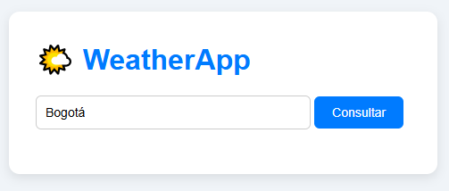
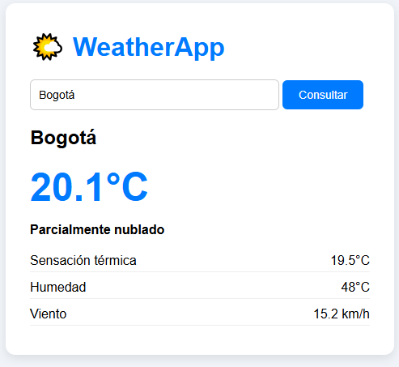

# WeatherApp

Aplicación web desarrollada en **.NET 8 Web API** que consume la API pública de **Open-Meteo** para mostrar el clima actual de cualquier ciudad del mundo. Containerizada con **Docker**.

## 🛠️ Tecnologías

- .NET 8 Web API
- C#
- HttpClient
- System.Text.Json
- HTML + JavaScript (frontend)
- Docker + Docker Compose

## 🚀 Funcionalidades

- ✅ Búsqueda de ciudad por nombre
- ✅ Consumo de API externa (Open-Meteo)
- ✅ Geocodificación (nombre → latitud/longitud)
- ✅ Interpretación de códigos meteorológicos
- ✅ Manejo de errores (ciudad no encontrada)
- ✅ Interfaz web simple y responsive

## 📡 API usada

[Open-Meteo](https://open-meteo.com/) — API gratuita de clima, sin necesidad de API key.

## 📸 Capturas

### Página inicial


### Consulta de clima


## ⚙️ Cómo ejecutar

### Requisitos
- Docker Desktop instalado
- WSL 2 (si estás en Windows)

### Pasos

1. Clonar el repositorio:
   ```bash
   git clone https://github.com/jesidcampos/weatherApp.git
   cd weatherApp

2. Levantar los contenedores:

docker compose up --build

3. Abrir en el navegador:

http://localhost:8081

Detener la aplicación

docker compose down

📂 Estructura del proyecto

weatherApp/
├── Controllers/
│   └── WeatherController.cs
├── Models/
│   └── ClimaResponse.cs
├── Services/
│   └── WeatherService.cs
├── wwwroot/
│   └── index.html
├── Dockerfile
├── docker-compose.yml
└── README.md

👤 Autor
José Yesid Campos Barbosa

Ingeniero de Sistemas | Desarrollador .NET | Soporte Técnico Remoto

LinkedIn: yesid-campos-barbosa

GitHub: @jesidcampos

text